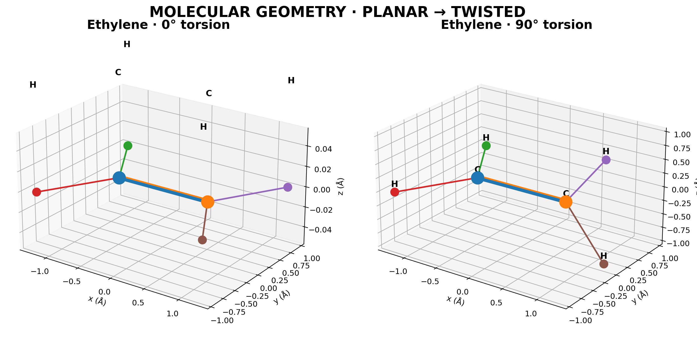
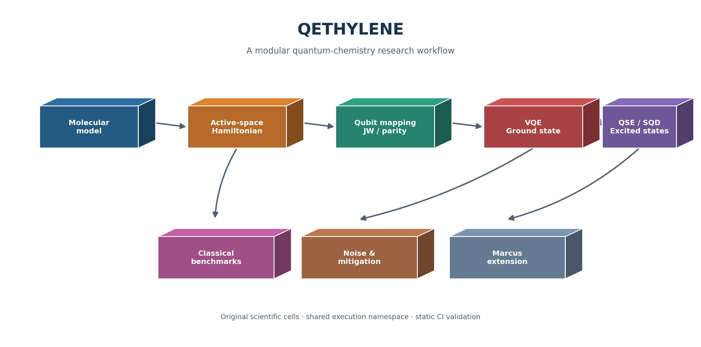

# QEthylene — Quantum Simulation of Photo-Induced Charge Dynamics

<div align="center">

**From ethylene's molecular orbitals to quantum algorithms, excited states, noise and electron transfer.**



</div>

---

## Project at a glance

This repository contains the original Jupyter Notebook and a modular Python-source organization of its existing code cells.

**Scientific content is preserved.** The notebook is copied unchanged. The extracted modules retain the original code-cell contents and execute in notebook order through a shared namespace. No scientific calculations are run by repository CI.

### Research workflow



### What the notebook covers

| Part | Existing notebook content |
|---|---|
| 1 | Ethylene molecular setup, active space, Jordan–Wigner and parity mapping |
| 2 | Ground-state VQE, UCCSD and hardware-efficient ansatz |
| 3 | Excited states with QSE, spin resolution, model comparison and torsion scan |
| 4 | Noise-aware benchmarking, readout mitigation and zero-noise extrapolation |
| 5 | Classical benchmarking with PySCF methods |
| 6 | Butadiene extension and Marcus electron-transfer rate |
| 7 | Improved basis selection and orbital-character analysis |
| 8 | Sample-based quantum diagonalization (SQD) and resource comparison |
| 9 | Headline values collected by the original notebook |

## Repository layout

```text
QEthylene/
├── .github/
│   └── workflows/
│       └── ci.yml
├── assets/
│   ├── ethylene_3d_geometry.png
│   ├── ethylene_3d_geometry.svg
│   ├── quantum_pipeline_3d.png
│   └── quantum_pipeline_3d.svg
├── src/
│   └── qethylene/
│       ├── __init__.py
│       ├── run_project.py
│       └── sections/
│           ├── 00_setup.py
│           ├── 01_molecular_setup.py
│           ├── 02_ground_state_vqe.py
│           ├── 03_excited_states_qse.py
│           ├── 04_noise_aware_benchmarking.py
│           ├── 05_classical_benchmarking.py
│           ├── 06_marcus_extension.py
│           ├── 07_improved_basis.py
│           ├── 08_sample_based_diagonalization.py
│           └── 09_headline_results.py
├── tests/
├── QEthylene_Final_Project.ipynb
├── requirements.txt
├── pyproject.toml
└── README.md
```

## Run options

### Original notebook

Open `QEthylene_Final_Project.ipynb` in Jupyter or Google Colab. Its cells and saved outputs are retained in the original file.

### Modular source

The extracted sections use shared notebook-style state: later sections depend on variables created earlier. Therefore, they are **not intended to be imported independently**.

From the repository root, after installing the dependencies:

```bash
python -m pip install -r requirements.txt
PYTHONPATH=src python -m qethylene.run_project
```

This command executes the scientific workflow. It is documented here for reproducibility; it is **not** run by CI.

> The original notebook includes package-install cells. The dependency list is also provided in `requirements.txt` for a conventional project setup. Versions are intentionally not pinned because the source notebook did not specify versions.

## CI

The GitHub Actions workflow performs static checks only:
- validates that the original notebook is readable JSON;
- compiles the extracted Python modules to check syntax;
- does **not** execute VQE, QSE, PySCF, Aer simulations, plots or other scientific calculations.

This keeps commits lightweight and avoids unexpectedly rerunning long numerical work.

## Preservation notes

- `QEthylene_Final_Project.ipynb` is the original uploaded notebook copied without editing.
- The section files are formed from the original code cells in their original order.
- The two notebook shell-install cells (`!pip install ...`) are represented as dependencies in `requirements.txt`; shell magics are not Python module syntax.
- Markdown explanations remain in the original notebook rather than being rewritten or silently redistributed.
- The 3D assets are repository presentation material; they do not alter the scientific notebook or its numerical results.

## Citation / provenance

The modular files are an organization of the notebook supplied for this repository preparation. They are not a new implementation of the underlying methods.
